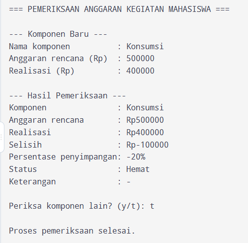
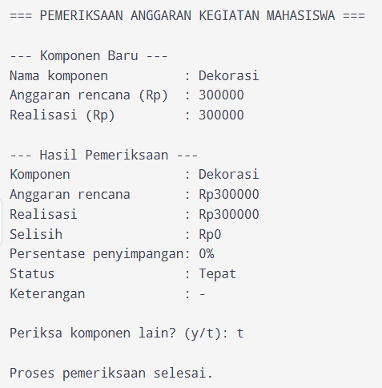
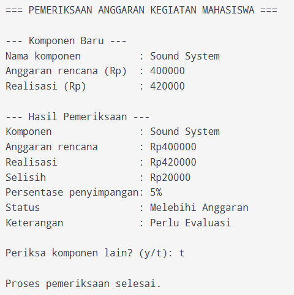
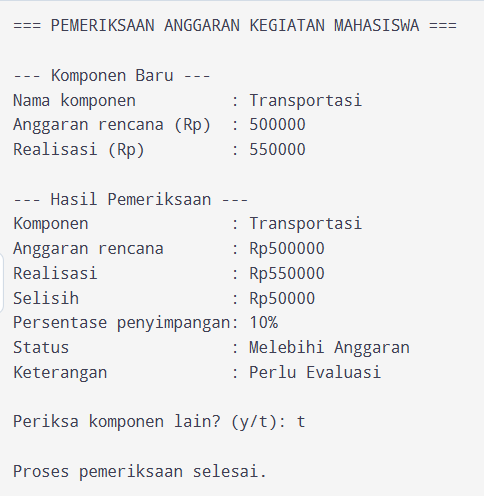
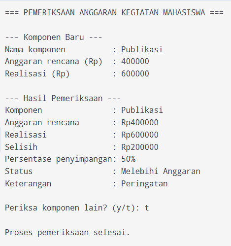
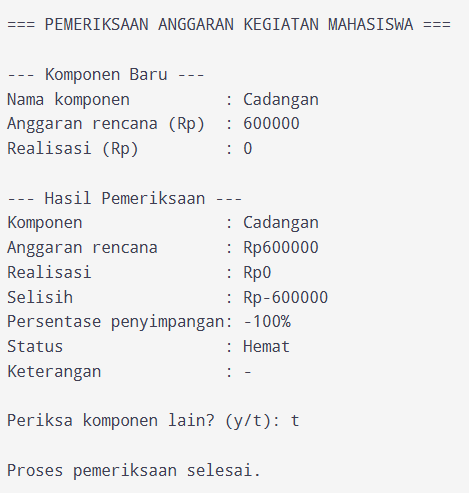
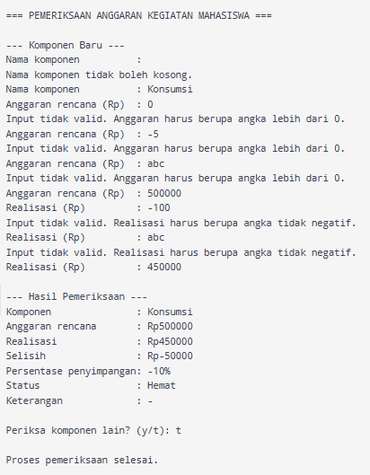
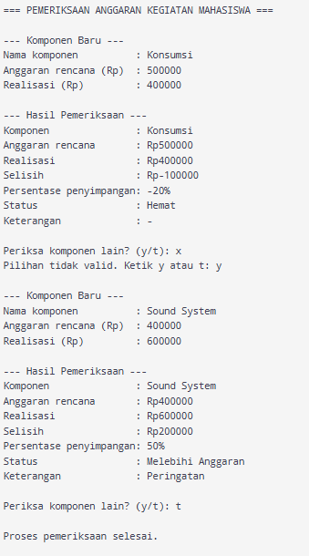

**Penanggung jawab:** Nadin Arifa Salsabila / 322610009

# Hasil Eksekusi dan Pengujian

Pada bagian ini program dijalankan beberapa kali dengan data yang berbeda-beda. Tujuannya untuk memastikan program memberi hasil yang benar, baik saat data yang dimasukkan benar maupun saat data yang dimasukkan salah.

Ada 8 skenario pengujian:

- **Skenario 1 sampai 6:** data benar, untuk menguji status Hemat, Tepat, dan Melebihi Anggaran, termasuk batas 10% dan nilai nol.
- **Skenario 7:** data salah, untuk menguji apakah program menolak dan meminta input ulang.
- **Skenario 8:** memeriksa lebih dari satu komponen sekaligus.

## Tabel Pengujian

| No. | Skenario | Data masukan | Hasil yang diharapkan | Hasil aktual | Status |
|-----|----------|--------------|-----------------------|--------------|--------|
| 1 | Input normal: uang yang dipakai lebih sedikit dari rencana | Konsumsi, 500000, 400000 | Hemat, selisih -100000, penyimpangan -20%, keterangan `-` | Hemat, selisih -100000, penyimpangan -20%, keterangan `-` | Berhasil |
| 2 | Uang yang dipakai sama dengan rencana | Dekorasi, 300000, 300000 | Tepat, selisih 0, penyimpangan 0%, keterangan `-` | Tepat, selisih 0, penyimpangan 0%, keterangan `-` | Berhasil |
| 3 | Melebihi rencana sedikit (5%) | Sound System, 400000, 420000 | Melebihi Anggaran, selisih 20000, penyimpangan 5%, keterangan Perlu Evaluasi | Melebihi Anggaran, selisih 20000, penyimpangan 5%, keterangan Perlu Evaluasi | Berhasil |
| 4 | Batas atas: melebihi rencana tepat 10% | Transportasi, 500000, 550000 | Melebihi Anggaran, selisih 50000, penyimpangan 10%, keterangan Perlu Evaluasi | Melebihi Anggaran, selisih 50000, penyimpangan 10%, keterangan Perlu Evaluasi | Berhasil |
| 5 | Melebihi rencana banyak (50%) | Publikasi, 400000, 600000 | Melebihi Anggaran, selisih 200000, penyimpangan 50%, keterangan Peringatan | Melebihi Anggaran, selisih 200000, penyimpangan 50%, keterangan Peringatan | Berhasil |
| 6 | Nilai nol: belum ada uang yang dipakai (realisasi 0) | Cadangan, 600000, 0 | Hemat, selisih -600000, penyimpangan -100%, keterangan `-` | Hemat, selisih -600000, penyimpangan -100%, keterangan `-` | Berhasil |
| 7 | Input tidak valid: nama kosong, anggaran 0, negatif, dan huruf, serta realisasi negatif dan huruf | Enter kosong, Konsumsi, `0`, `-5`, `abc`, 500000, `-100`, `abc`, 450000 | Semua input salah ditolak dan diminta ulang, input yang benar diterima, lalu Hemat | Nama kosong ditolak sekali, anggaran ditolak tiga kali, realisasi ditolak dua kali, lalu data benar diterima dengan hasil Hemat, selisih -50000, -10% | Berhasil |
| 8 | Banyak komponen dan pilihan lanjut salah | Konsumsi, 500000, 400000, `x`, `y`; Sound System, 400000, 600000, `T` | Pilihan `x` ditolak, dua komponen diproses, program berhenti setelah `T` | Pilihan `x` ditolak, komponen 1 Hemat, komponen 2 Melebihi Anggaran dengan keterangan Peringatan, program berhenti setelah `T` | Berhasil |

## Hasil Eksekusi

### Skenario 1: Hemat

Realisasi (400000) lebih kecil dari anggaran (500000), jadi statusnya Hemat.

### Skenario 2: Tepat

Realisasi sama persis dengan anggaran, jadi statusnya Tepat.

### Skenario 3: Melebihi Anggaran 5%

Kelebihan 5% masih di bawah 10%, jadi keterangannya Perlu Evaluasi.

### Skenario 4: Tepat di batas 10%

Kelebihan tepat 10% masih dihitung Perlu Evaluasi. Keterangan Peringatan baru muncul kalau lebih dari 10%.

### Skenario 5: Melebihi Anggaran 50%

Kelebihan 50% sudah jauh di atas 10%, jadi keterangannya Peringatan.

### Skenario 6: Realisasi nol

Realisasi 0 tetap diterima (belum ada uang yang dipakai), dan statusnya Hemat.

### Skenario 7: Input tidak valid

Pada skenario ini semua jenis kesalahan dicoba berturut-turut: nama kosong, anggaran 0, negatif, dan huruf, serta realisasi negatif dan huruf. Program menolak semuanya dan baru lanjut setelah datanya benar.

### Skenario 8: Memeriksa dua komponen dan pilihan lanjut salah

Saat ditanya lanjut atau tidak, huruf `x` ditolak. Setelah menjawab `y`, program mengulang untuk komponen kedua. Setelah menjawab `T`, program berhenti.

## Kesimpulan Pengujian

Dari 8 skenario yang diuji, semuanya berhasil dan hasilnya sesuai dengan yang diharapkan.

- Program bisa menentukan status Hemat, Tepat, dan Melebihi Anggaran dengan benar, termasuk saat kelebihannya tepat 10% dan saat realisasi bernilai 0.
- Program menolak data yang salah (nama kosong, angka nol atau negatif, huruf, dan pilihan selain y atau t) tanpa berhenti mendadak.
- Program bisa memeriksa lebih dari satu komponen dalam satu kali dijalankan.