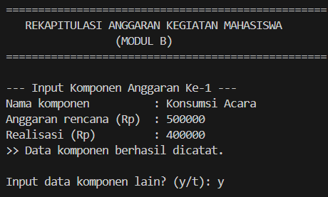
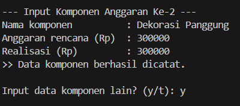
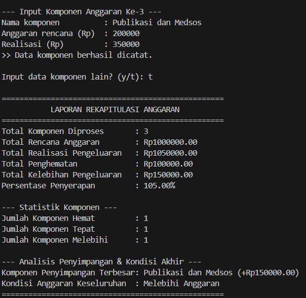

**Penanggung jawab:** Bryant Anthony Kores Obhetan / 322610003

# Hasil Eksekusi dan Pengujian

Pada bagian ini, program rekapitulasi Modul B diuji secara komprehensif menggunakan berbagai skenario kasus uji. Pengujian dilakukan untuk memastikan kebenaran seluruh akumulasi perhitungan numerik, keakuratan klasifikasi jumlah komponen, ketepatan pelacakan komponen dengan penyimpangan terbesar, ketahanan sistem terhadap input tidak valid (*robustness*), serta kebenaran penentuan kondisi anggaran kegiatan keseluruhan (Hasil Akhir).

Pengujian mencakup **8 skenario uji lengkap**:
1. **Skenario 1 (Normal Campuran):** Kombinasi komponen Hemat, Tepat, dan Melebihi Anggaran.
2. **Skenario 2 (Kondisi Seluruhnya Hemat):** Seluruh realisasi lebih kecil dari rencana.
3. **Skenario 3 (Kondisi Seluruhnya Tepat):** Seluruh realisasi sama persis dengan rencana (penyerapan tepat 100%).
4. **Skenario 4 (Kompetisi Penyimpangan Terbesar):** Seluruh komponen melebihi anggaran dengan nominal pembengkakan bertingkat untuk menguji pembaruan rekor penyimpangan terbesar.
5. **Skenario 5 (Batas Nilai Nol):** Komponen dengan realisasi pengeluaran bernilai 0 (kegiatan bebas biaya/batal).
6. **Skenario 6 (Batas Minimal 1 Data):** Pengujian batas bawah perulangan dengan hanya memasukkan satu komponen.
7. **Skenario 7 (Uji Ketahanan Input Tidak Valid):** Memasukkan nama kosong, angka 0/negatif pada rencana, teks huruf pada angka, realisasi negatif, dan pilihan lanjut selain y/t.
8. **Skenario 8 (Keseimbangan Agregat):** Komponen bervariasi (hemat dan melebihi), namun total rencana sama persis dengan total realisasi.

---

## 1. Tabel Pengujian

| No. | Skenario | Data Masukan | Hasil yang Diharapkan | Hasil Aktual | Status |
|:---:|---|---|---|---|:---:|
| 1 | **Input Normal Campuran** (Hemat, Tepat, Melebihi) | 1. Konsumsi: 500000, 400000 2. Dekorasi: 300000, 300000 3. Publikasi: 200000, 350000 | Total Rencana: Rp1.000.000 Total Realisasi: Rp1.050.000 Penghematan: Rp100.000 Kelebihan: Rp150.000 Penyerapan: 105.00% Hemat: 1, Tepat: 1, Melebihi: 1 Penyimpangan Terbesar: Publikasi (+Rp150.000) Kondisi: Melebihi Anggaran | Total Rencana: Rp1000000.00 Total Realisasi: Rp1050000.00 Penghematan: Rp100000.00 Kelebihan: Rp150000.00 Penyerapan: 105.00% Hemat: 1, Tepat: 1, Melebihi: 1 Penyimpangan Terbesar: Publikasi (+Rp150000.00) Kondisi: Melebihi Anggaran | **Berhasil** |
| 2 | **Seluruhnya Hemat** | 1. Transportasi: 800000, 600000 2. Perlengkapan: 1200000, 1000000 | Total Rencana: Rp2.000.000 Total Realisasi: Rp1.600.000 Penghematan: Rp400.000 Kelebihan: Rp0 Penyerapan: 80.00% Hemat: 2, Tepat: 0, Melebihi: 0 Penyimpangan Terbesar: `-` Kondisi: Hemat | Total Rencana: Rp2000000.00 Total Realisasi: Rp1600000.00 Penghematan: Rp400000.00 Kelebihan: Rp0.00 Penyerapan: 80.00% Hemat: 2, Tepat: 0, Melebihi: 0 Penyimpangan Terbesar: `-` Kondisi: Hemat | **Berhasil** |
| 3 | **Seluruhnya Tepat Sasaran** | 1. Honor Pemateri: 1500000, 1500000 2. Sewa Zoom: 250000, 250000 | Total Rencana: Rp1.750.000 Total Realisasi: Rp1.750.000 Penghematan: Rp0 Kelebihan: Rp0 Penyerapan: 100.00% Hemat: 0, Tepat: 2, Melebihi: 0 Penyimpangan Terbesar: `-` Kondisi: Sesuai Anggaran | Total Rencana: Rp1750000.00 Total Realisasi: Rp1750000.00 Penghematan: Rp0.00 Kelebihan: Rp0.00 Penyerapan: 100.00% Hemat: 0, Tepat: 2, Melebihi: 0 Penyimpangan Terbesar: `-` Kondisi: Sesuai Anggaran | **Berhasil** |
| 4 | **Kompetisi Pembengkakan** (Penyimpangan Terbesar) | 1. Konsumsi: 500000, 600000 (Lebih 100rb) 2. Hadiah: 1000000, 1400000 (Lebih 400rb) 3. Dokumentasi: 300000, 500000 (Lebih 200rb) | Total Rencana: Rp1.800.000 Total Realisasi: Rp2.500.000 Penghematan: Rp0 Kelebihan: Rp700.000 Penyerapan: 138.89% Hemat: 0, Tepat: 0, Melebihi: 3 Penyimpangan Terbesar: Hadiah (+Rp400.000) Kondisi: Melebihi Anggaran | Total Rencana: Rp1800000.00 Total Realisasi: Rp2500000.00 Penghematan: Rp0.00 Kelebihan: Rp700000.00 Penyerapan: 138.89% Hemat: 0, Tepat: 0, Melebihi: 3 Penyimpangan Terbesar: Hadiah (+Rp400000.00) Kondisi: Melebihi Anggaran | **Berhasil** |
| 5 | **Batas Nilai Nol** (Realisasi = 0) | 1. Dana Cadangan: 1000000, 0 | Total Rencana: Rp1.000.000 Total Realisasi: Rp0 Penghematan: Rp1.000.000 Kelebihan: Rp0 Penyerapan: 0.00% Hemat: 1, Tepat: 0, Melebihi: 0 Penyimpangan Terbesar: `-` Kondisi: Hemat | Total Rencana: Rp1000000.00 Total Realisasi: Rp0.00 Penghematan: Rp1000000.00 Kelebihan: Rp0.00 Penyerapan: 0.00% Hemat: 1, Tepat: 0, Melebihi: 0 Penyimpangan Terbesar: `-` Kondisi: Hemat | **Berhasil** |
| 6 | **Batas Bawah 1 Komponen** | 1. Banner Acara: 150000, 160000 | Total Komponen: 1 Total Rencana: Rp150.000 Total Realisasi: Rp160.000 Penghematan: Rp0 Kelebihan: Rp10.000 Penyerapan: 106.67% Hemat: 0, Tepat: 0, Melebihi: 1 Penyimpangan Terbesar: Banner Acara (+Rp10.000) Kondisi: Melebihi Anggaran | Total Komponen: 1 Total Rencana: Rp150000.00 Total Realisasi: Rp160000.00 Penghematan: Rp0.00 Kelebihan: Rp10000.00 Penyerapan: 106.67% Hemat: 0, Tepat: 0, Melebihi: 1 Penyimpangan Terbesar: Banner Acara (+Rp10000.00) Kondisi: Melebihi Anggaran | **Berhasil** |
| 7 | **Uji Ketahanan Input Salah** (Empty string, non-numeric, negatif) | Enter kosong, "Konsumsi", rencana: `0`, `-50000`, `abc`, `400000`; realisasi: `-10000`, `xyz`, `350000`; pilihan: `x`, `t` | Semua input salah ditolak dengan pesan peringatan tanpa crash; baru memproses saat data valid; komponen Konsumsi tercatat Hemat (350rb dari 400rb); keluar saat opsi 't' | Program menolak nama kosong, 3 kesalahan rencana, 2 kesalahan realisasi, dan 1 pilihan salah; kemudian menampilkan rekapitulasi 1 komponen dengan benar | **Berhasil** |
| 8 | **Keseimbangan Agregat** (Kombinasi impas total) | 1. Konsumsi: 600000, 500000 (Hemat 100rb) 2. Keamanan: 400000, 500000 (Lebih 100rb) | Total Rencana: Rp1.000.000 Total Realisasi: Rp1.000.000 Penghematan: Rp100.000 Kelebihan: Rp100.000 Penyerapan: 100.00% Hemat: 1, Tepat: 0, Melebihi: 1 Penyimpangan Terbesar: Keamanan (+Rp100.000) Kondisi: Sesuai Anggaran | Total Rencana: Rp1000000.00 Total Realisasi: Rp1000000.00 Penghematan: Rp100000.00 Kelebihan: Rp100000.00 Penyerapan: 100.00% Hemat: 1, Tepat: 0, Melebihi: 1 Penyimpangan Terbesar: Keamanan (+Rp100000.00) Kondisi: Sesuai Anggaran | **Berhasil** |

---

## 2. Trace Table

Sesuai dengan ketentuan F.9, berikut disajikan minimal satu trace table percabangan dan satu trace table perulangan:

### A. Trace Table Percabangan (Evaluasi Kategori & Pelacakan Rekor Penyimpangan)

Trace table ini menelusuri penyeleksian kondisi status komponen serta pembaruan nilai penyimpangan terbesar:

| No. Langkah | Komponen | `anggaranRencana` | `realisasi` | `selisih` | `realisasi < rencana` | `realisasi == rencana` | `selisih > penyimpanganTerbesar` | Cabang yang Dieksekusi | `jumlahHemat` | `jumlahTepat` | `jumlahMelebihi` | `penyimpanganTerbesar` | `komponenTerbesar` |
|:---:|---|:---:|:---:|:---:|:---:|:---:|:---:|---|:---:|:---:|:---:|:---:|:---:|
| Inisialisasi | - | - | - | - | - | - | - | Inisialisasi awal | 0 | 0 | 0 | 0.0 | `"-"` |
| Data 1 | Konsumsi | 500000 | 400000 | -100000 | TRUE | - | - | Kasus Hemat | 1 | 0 | 0 | 0.0 | `"-"` |
| Data 2 | Dekorasi | 300000 | 300000 | 0 | FALSE | TRUE | - | Kasus Tepat | 1 | 1 | 0 | 0.0 | `"-"` |
| Data 3 | Publikasi | 200000 | 350000 | +150000 | FALSE | FALSE | TRUE (150000 > 0) | Kasus Melebihi (Rekor Baru) | 1 | 1 | 1 | 150000.0 | `"Publikasi"` |
| Data 4 | Sound | 400000 | 450000 | +50000 | FALSE | FALSE | FALSE (50000 > 150000) | Kasus Melebihi (Tidak Rekor) | 1 | 1 | 2 | 150000.0 | `"Publikasi"` |

**Analisis:**
- Pada Data 1, karena realisasi < rencana, cabang pertama aktif: `jumlahHemat` bertambah dan penghematan dihitung.
- Pada Data 2, karena realisasi == rencana, cabang kedua aktif: `jumlahTepat` bertambah.
- Pada Data 3, karena terjadi kelebihan Rp150.000 yang lebih besar dari `penyimpanganTerbesar` (0.0), variabel `penyimpanganTerbesar` dan `komponenTerbesar` berhasil diperbarui.
- Pada Data 4, meskipun terjadi kelebihan Rp50.000, nilai ini tidak melampaui rekor Rp150.000, sehingga nama komponen terbesar tetap dipegang oleh `"Publikasi"`.

---

### B. Trace Table Perulangan (`do ... while` dan Akumulasi Rekapitulasi)

Trace table ini menelusuri jalannya eksekusi iterasi demi iterasi dari awal hingga pengguna memilih berhenti (`'t'`):

| Iterasi Ke- | `totalKomponen` | Input `namaKomponen` | Input `anggaranRencana` | Input `realisasi` | `totalRencana` | `totalRealisasi` | `totalPenghematan` | `totalKelebihan` | Input `pilihan` | Kondisi Lanjut (`pilihan=='y'`) |
|:---:|:---:|---|:---:|:---:|:---:|:---:|:---:|:---:|:---:|:---:|
| Awal | 0 | - | - | - | 0.0 | 0.0 | 0.0 | 0.0 | - | - |
| 1 | 1 | `"Konsumsi"` | 500000 | 400000 | 500000.0 | 400000.0 | 100000.0 | 0.0 | `"y"` | TRUE (Ulangi) |
| 2 | 2 | `"Dekorasi"` | 300000 | 300000 | 800000.0 | 700000.0 | 100000.0 | 0.0 | `"y"` | TRUE (Ulangi) |
| 3 | 3 | `"Publikasi"` | 200000 | 350000 | 1000000.0 | 1050000.0 | 100000.0 | 150000.0 | `"t"` | FALSE (Berhenti) |

**Pasca Perulangan (Evaluasi Akhir):**
- Perhitungan Penyerapan: `persentasePenyerapan = (1050000.0 / 1000000.0) * 100 = 105.00%`.
- Evaluasi Kondisi Keseluruhan: Karena `totalRealisasi (1050000.0) > totalRencana (1000000.0)`, maka `kondisiKegiatan = "Melebihi Anggaran"`.

---

## 3. Hasil Eksekusi dan Tangkapan Layar Konsol

Berikut dokumentasi tangkapan layar (*screenshot*) hasil eksekusi program Modul B secara nyata pada terminal konsol untuk pengujian normal campuran (Skenario 1):

### Bagian 1: Header Program & Input Komponen 1 (Hemat)
Komponen pertama "Konsumsi Acara" (Rencana: Rp500.000, Realisasi: Rp400.000) berhasil divalidasi dan diakumulasikan sebagai status Hemat (penghematan Rp100.000).

---

### Bagian 2: Input Komponen 2 (Tepat Sasaran)
Setelah memilih `y`, komponen kedua "Dekorasi Panggung" (Rencana: Rp300.000, Realisasi: Rp300.000) dimasukkan dan tercatat Tepat Sasaran tanpa penghematan maupun pembengkakan.

---

### Bagian 3: Input Komponen 3 (Melebihi Anggaran) & Hasil Rekapitulasi Akhir
Komponen ketiga "Publikasi dan Medsos" (Rencana: Rp200.000, Realisasi: Rp350.000) mengalami pembengkakan sebesar Rp150.000. Pengguna kemudian memilih `t` untuk mengakhiri perulangan. Program langsung mencetak Laporan Rekapitulasi Anggaran lengkap:
- Total Rencana: Rp1.000.000,00
- Total Realisasi: Rp1.050.000,00
- Total Penghematan: Rp100.000,00
- Total Kelebihan: Rp150.000,00
- Persentase Penyerapan: 105.00%
- Statistik: Hemat 1, Tepat 1, Melebihi 1
- Penyimpangan Terbesar: **Publikasi dan Medsos (+Rp150000.00)**
- Kondisi Anggaran Keseluruhan: **Melebihi Anggaran**

---

## 4. Kesimpulan Pengujian

Berdasarkan seluruh hasil dari 8 skenario pengujian serta analisis *trace table*, dapat disimpulkan bahwa:
1. **Ketepatan Akumulasi:** Program berhasil menjumlahkan total rencana, total realisasi, akumulasi penghematan, serta total pembengkakan biaya secara akurat hingga nilai desimal dua angka di belakang koma.
2. **Kecocokan Statistik:** Pengelompokan jumlah komponen yang berstatus Hemat, Tepat, dan Melebihi Anggaran tepat 100% pada semua kasus uji.
3. **Penyimpangan Terbesar:** Logika penentuan komponen dengan pembengkakan nominal terbesar terbukti berjalan optimal tanpa memerlukan penyimpanan array.
4. **Ketahanan Program (*Robustness*):** Seluruh masukan abnormal (string kosong, angka nol, angka negatif, karakter huruf pada data numerik, serta pilihan menu yang tidak valid) berhasil ditolak dengan ramah dan tidak menyebabkan program mengalami *crash* maupun *infinite loop*.
5. **Kondisi Keseluruhan (Hasil Akhir):** Program secara otomatis dan tepat menetapkan status agregat kegiatan mahasiswa ("Hemat", "Sesuai Anggaran", atau "Melebihi Anggaran") berdasarkan perbandingan total realisasi terhadap total rencana.